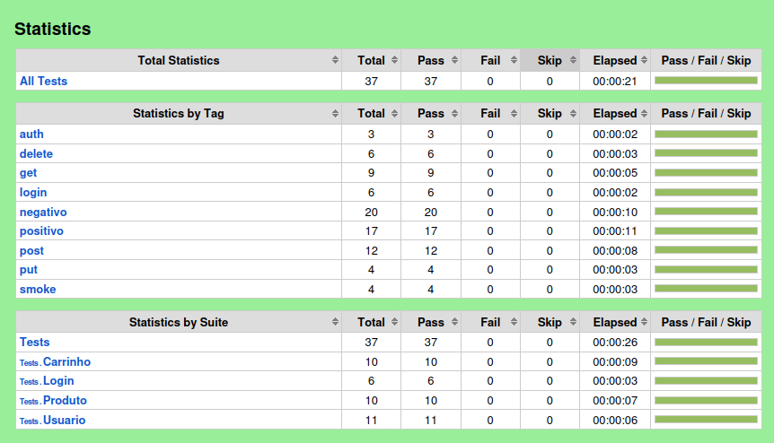

# Testes automatizados da API ServeRest com Robot Framework

Este projeto contém testes automatizados de API REST da aplicação [ServeRest](https://serverest.dev/), desenvolvidos com Robot Framework e RequestsLibrary, com o objetivo de validar seus principais fluxos funcionais, regras de negócio, autenticação e permissões de acesso.

## Tecnologias e Ferramentas utilizadas

- **Linguagem:** Python 3.12
- **Framework de Automação:** Robot Framework v7.5
- **Biblioteca de Requisições HTTP:** RequestsLibrary (`robotframework-requests`)
- **Bibliotecas Nativas:** Collections e String

## Estrutura do projeto

```text
josewolf-teste-de-API-robot-framework/
├── docs/
│   └── images/
│       └── report.png
├── resource/
│   ├── base.resource
│   └── endpoint/
│       ├── usuario.resource
│       ├── login.resource
│       ├── produto.resource
│       └── carrinho.resource
├── tests/
│   ├── usuario.robot
│   ├── login.robot
│   ├── produto.robot
│   └── carrinho.robot
├── .gitignore
├── requirements.txt
└── README.md
```

- **resource/base.resource:** centraliza as bibliotecas, a conexão global com a sessão da API (`Create Session`) e as validações genéricas reutilizáveis.
- **resource/endpoint/:** contém a geração de massa de dados dinâmica, as keywords de chamadas HTTP (`GET`, `POST`, `PUT`, `DELETE`) e as validações específicas de cada rota da API.
- **tests/:** contém as suítes e os cenários de teste automatizados organizados por endpoint.
- **requirements.txt:** contém as dependências necessárias para executar o projeto.

## Pré-requisitos

Antes de executar o projeto, é necessário ter instalado:

- Python 3.12
- Git
- pip

## Como executar o projeto

### 1. Clonar o repositório

```bash
git clone https://github.com/jose-wolf/josewolf-teste-de-API-robot-framework.git
cd josewolf-teste-de-API-robot-framework
```

### 2. Criar e ativar o ambiente virtual

#### Linux

```bash
python3 -m venv .venv
source .venv/bin/activate
```

#### Windows — PowerShell

```bash
python -m venv .venv
.venv\Scripts\activate
```

#### Windows — Git Bash

```bash
python -m venv .venv
source .venv/Scripts/activate
```

### 3. Instalar as dependências

```bash
pip install -r requirements.txt
```

### 4. Executar os testes

Para executar todos os testes:

```bash
robot -d results tests/
```

Para executar somente uma suíte específica:

```bash
robot -d results tests/usuario.robot
```

Para executar filtrando por tags (ex: `smoke`, `positivo` ou `negativo`):

```bash
robot -d results -i smoke tests/
```

## Cenários cobertos

### Usuários (`/usuarios`)

| ID | Cenário | Método | Tipo | Resultado esperado |
| --- | --- | --- | --- | --- |
| USR-001 | Cadastrar um novo usuário com sucesso | `POST` | Positivo | Status `201` e retorna `_id` com mensagem de cadastro realizado |
| USR-002 | Não permitir cadastrar usuário com e-mail duplicado | `POST` | Negativo | Status `400` informando que o e-mail já está sendo usado |
| USR-003 | Não permitir cadastrar usuário com e-mail em branco | `POST` | Negativo | Status `400` informando que o campo `email` não pode ficar em branco |
| USR-004 | Listar todos os usuários cadastrados | `GET` | Positivo | Status `200` e retorna a lista de usuários cadastrados |
| USR-005 | Buscar um usuário específico por ID com sucesso | `GET` | Positivo | Status `200` e retorna os dados correspondentes ao usuário cadastrado |
| USR-006 | Não buscar usuário com `_id` inexistente | `GET` | Negativo | Status `400` informando que o usuário não foi encontrado |
| USR-007 | Editar os dados de um usuário com sucesso | `PUT` | Positivo | Status `200` informando que o registro foi alterado com sucesso |
| USR-008 | Criar usuário via PUT se não existir cadastro | `PUT` | Positivo | Status `201` criando um novo usuário e retornando o `_id` gerado |
| USR-009 | Não atualizar dados com e-mail duplicado | `PUT` | Negativo | Status `400` informando que o e-mail já está sendo usado |
| USR-010 | Deletar o usuário com sucesso | `DELETE` | Positivo | Status `200` informando que o registro foi excluído com sucesso |
| USR-011 | Não deletar usuário com `_id` inexistente | `DELETE` | Negativo | Status `200` informando que nenhum registro foi excluído |

### Login (`/login`)

| ID | Cenário | Método | Tipo | Resultado esperado |
| --- | --- | --- | --- | --- |
| LOGIN-001 | Realizar login com sucesso | `POST` | Positivo | Status `200` com mensagem de sucesso e token `Bearer` no campo `authorization` |
| LOGIN-002 | Não realizar login sem e-mail | `POST` | Negativo | Status `400` informando que o campo `email` não pode ficar em branco |
| LOGIN-003 | Não realizar login sem senha | `POST` | Negativo | Status `400` informando que o campo `password` não pode ficar em branco |
| LOGIN-004 | Não realizar login sem dados preenchidos | `POST` | Negativo | Status `400` informando obrigatoriedade de `email` e `password` |
| LOGIN-005 | Não realizar login com e-mail não cadastrado | `POST` | Negativo | Status `401` informando e-mail e/ou senha inválidos |
| LOGIN-006 | Não realizar login com senha incorreta | `POST` | Negativo | Status `401` informando e-mail e/ou senha inválidos |

### Produtos (`/produtos`)

| ID | Cenário | Método | Tipo | Resultado esperado |
| --- | --- | --- | --- | --- |
| PROD-001 | Cadastrar um novo produto com sucesso | `POST` | Positivo | Status `201` e retorna `_id` do produto criado |
| PROD-002 | Não permitir cadastrar produto com nome duplicado | `POST` | Negativo | Status `400` informando que já existe produto com esse nome |
| PROD-003 | Não permitir cadastrar produto sem token de autenticação | `POST` | Negativo | Status `401` informando token de acesso ausente ou inválido |
| PROD-004 | Não permitir cadastrar produto com usuário não-administrador | `POST` | Negativo | Status `403` informando rota exclusiva para administradores |
| PROD-005 | Listar todos os produtos cadastrados | `GET` | Positivo | Status `200` e retorna a lista de produtos |
| PROD-006 | Buscar um produto específico por ID com sucesso | `GET` | Positivo | Status `200` e retorna nome, preço, descrição e quantidade do produto |
| PROD-007 | Não buscar produto com `_id` inexistente | `GET` | Negativo | Status `400` informando que o produto não foi encontrado |
| PROD-008 | Editar os dados de um produto com sucesso | `PUT` | Positivo | Status `200` informando que o registro foi alterado com sucesso |
| PROD-009 | Deletar um produto com sucesso | `DELETE` | Positivo | Status `200` informando que o registro foi excluído com sucesso |
| PROD-010 | Não deletar produto com `_id` inexistente | `DELETE` | Negativo | Status `200` informando que nenhum registro foi excluído |

### Carrinhos (`/carrinhos`)

| ID | Cenário | Método | Tipo | Resultado esperado |
| --- | --- | --- | --- | --- |
| CART-001 | Cadastrar um novo carrinho com sucesso | `POST` | Positivo | Status `201` e retorna `_id` do carrinho criado |
| CART-002 | Não permitir ter mais de um carrinho ativo para o mesmo usuário | `POST` | Negativo | Status `400` informando que não é permitido ter mais de 1 carrinho |
| CART-003 | Não permitir cadastrar carrinho com produto inexistente | `POST` | Negativo | Status `400` informando que o produto não foi encontrado |
| CART-004 | Não permitir cadastrar carrinho com quantidade maior que o estoque | `POST` | Negativo | Status `400` informando que o produto não possui quantidade suficiente |
| CART-005 | Não permitir cadastrar carrinho sem token de autenticação | `POST` | Negativo | Status `401` informando token de acesso ausente ou inválido |
| CART-006 | Listar todos os carrinhos cadastrados | `GET` | Positivo | Status `200` e retorna a lista de carrinhos |
| CART-007 | Buscar um carrinho específico por ID com sucesso | `GET` | Positivo | Status `200` e retorna produtos, `precoTotal` e `_id` do carrinho |
| CART-008 | Não buscar carrinho com `_id` inexistente | `GET` | Negativo | Status `400` informando que o carrinho não foi encontrado |
| CART-009 | Concluir uma compra (excluir carrinho) com sucesso | `DELETE` | Positivo | Status `200` informando que o registro foi excluído com sucesso |
| CART-010 | Cancelar uma compra e reabastecer o estoque com sucesso | `DELETE` | Positivo | Status `200` informando exclusão do registro e estoque reabastecido |

## Relatórios

Após a execução dos testes, o Robot Framework gera os arquivos de resultado na pasta `results/`.

Os principais arquivos são:

- `results/report.html`: apresenta o resumo da execução dos testes.
- `results/log.html`: apresenta os detalhes das suítes, cenários e keywords executadas.
- `results/output.xml`: contém os resultados da execução em formato XML.

Para visualizar os resultados, abra `report.html` ou `log.html` em um navegador.

## Evidência de execução

A suíte completa possui atualmente **37 testes automatizados**.

Resultado da última execução:

- **37 testes executados**
- **37 testes aprovados**
- **0 testes reprovados**



## Próximos passos

- Integrar a execução dos testes em pipeline de CI/CD com GitHub Actions.
- Adicionar validação automatizada de contrato (JSON Schema).

## Autor

**José Wolf**

[LinkedIn](https://www.linkedin.com/in/jose-wolf/)
